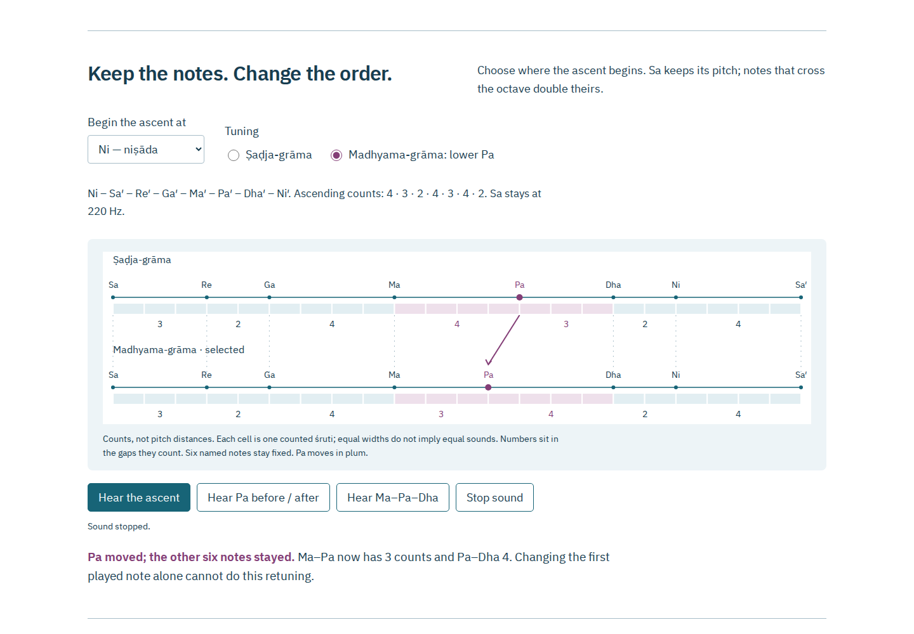
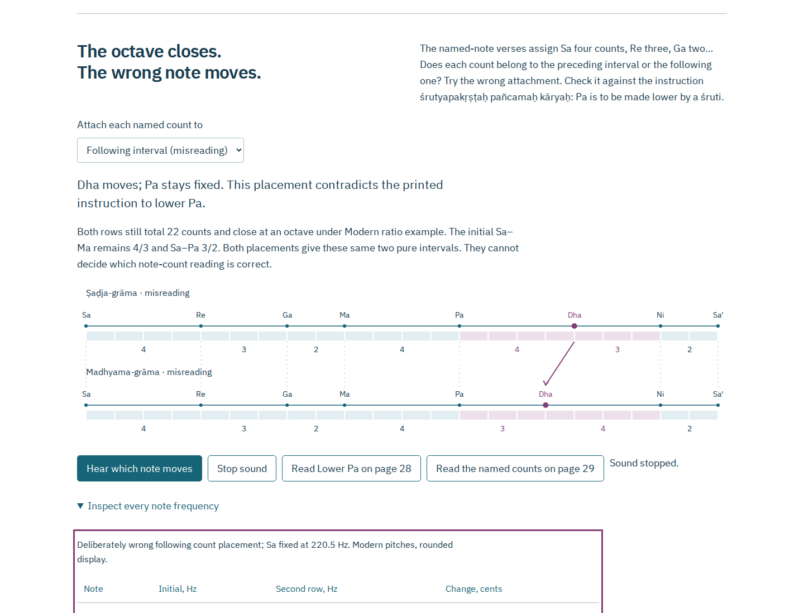
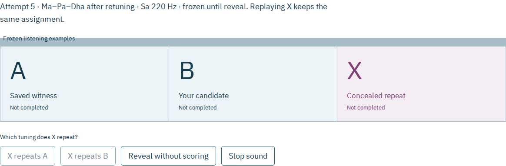
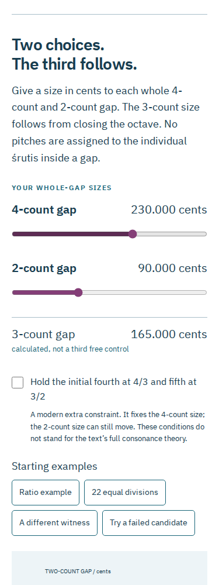

# Grāma

Change a starting note, lower one string, and read the Sanskrit behind the two grāmas.

[](LICENSE)
[](https://antonsoo.github.io/grama/)



A different first note can make a scale sound different without retuning a
single note. Early Indian music theory also describes a different operation:
lower Pa by one śruti. Its two adjacent interval groups exchange a count,
from 4–3 to 3–4. Grāma lets you distinguish those actions, read their Sanskrit
instructions, and inspect what the count twenty-two does and does not tell us.

**[Open the bench](https://antonsoo.github.io/grama/)** ·
[Source repository](https://github.com/antonsoo/grama) ·
[Publication evidence](docs/publication.md).

## Try the bench

With Node 24 or later:

```sh
npm ci
npm run dev
```

Open `http://127.0.0.1:4394/grama/`. No API key, account or external service is
needed. `npm run build` writes the complete static site to `dist/`;
`npm run preview` serves that production build on the same local port.
1. Begin at Re. The ascent changes order; Sa remains 220 Hz.
2. Select **Madhyama-grāma: lower Pa**. Ma–Pa loses a count, Pa–Dha gains one,
   and the other six notes keep their pitches.
3. Hear Pa before and after, or hear Ma–Pa–Dha in both tunings.
4. Switch the stated pitch assumption. The same count change gives a different
   numerical lowering, exposing the extra assumption needed to make sound.
5. Read **Lower Pa**, then the named count verses, with Sanskrit word notes and
   the full printed pages alongside them.

The two rows show the exact distinction:

```text
                    Ma          Pa          Dha
Sadja-grama           o---4--------o---3-------o
                                  |
                                  v lower Pa
Madhyama-grama        o---3-----o------4-------o
                     fixed     Pa           fixed
```

Diagram spacing counts ordinal groups, not equal pitch steps or string lengths.
The app has a separate logarithmic pitch ruler.

## The octave closes. The wrong note moves.

**Check the counts** in the count bench deliberately attaches each named count
to the following interval. The ratio model still closes at 2:1 and retains its
4:3 fourth and 3:2 fifth. Yet Dha moves while Pa stays fixed. Switch to the
preceding-interval reading and the retuning moves Pa, as the Sanskrit instructs.

Hear both rows, inspect the complete printed pages 28–29, and save the diagram,
CSV or WAV. Comparison JSON v3 and the illustrated reading preserve this choice;
older comparisons still reopen. [Source, model and audit](docs/listening-audit.md).



## Can you hear which tuning?

The tuning bench has a **[Listening](https://antonsoo.github.io/grama/tuning.html#listening)** exercise. Set up two witnesses ten cents apart
at lowered Pa, freeze them as A and B, then identify a concealed repeat X.
Replays keep the same X. Reveal your answer to inspect the actual frequencies;
try the unchanged-Ma control to hear a pair that produces identical samples.



Earlier attempts retain their own sounds after the live bench changes. Save a
reopenable JSON record, or keep the revealed record as CSV or a complete script-free study with sound, Sanskrit and
all eleven source pages. This is self-guided listening practice, not a hearing
threshold measurement or a reconstruction of ancient performance.

Run locally, then open `http://127.0.0.1:4394/grama/tuning.html#listening`.
[Exercise, model and local verification](docs/listening-review.md) ·
[Example study, gzip](examples/listening/study.html.gz) ·
[Printable study](examples/listening/study.pdf) · [Attempt CSV](examples/listening/record.csv) ·
[Reopenable example record](examples/listening/record.json).
The example is an automated verification record, not a human listening result.
Decompress its HTML before opening it; the app saves ordinary HTML.
The hosted exercise and the count-placement diagnostic are published;
[current audit](docs/listening-audit.md) records their source and local behavior.

## Build another tuning

**[Twenty-two counts. Find another tuning.](https://antonsoo.github.io/grama/tuning.html)**
opens the whole-gap experiment. Follow **Find another tuning** from the count
bench, or run it locally at `http://127.0.0.1:4394/grama/tuning.html`.

Leave the fourth/fifth lock on, focus the **2-count gap** slider and press
**Shift + Right**. The initial Sa–Ma and Sa–Pa remain at 4/3 and 3/2;
Pa’s lowering changes by ten cents. The count row and octave still agree.

| Whole-gap assumption         | Four counts | Three counts | Two counts | Pa lowers |
| ---------------------------- | ----------: | -----------: | ---------: | --------: |
| Ratio example                |     203.910 |      182.404 |    111.731 |    21.506 |
| Move the two-count gap by 10 |     203.910 |      172.404 |    121.731 |    31.506 |
| A different witness          |     230.000 |      165.000 |     90.000 |    65.000 |

All sizes are rounded cents. These are modern numerical witnesses, not recovered
ancient tunings. A fourth/fifth pair does not stand for all the text’s consonance
requirements. The workshop states its equal-whole-gap assumption, derives octave
closure, and keeps failed candidates visible. **Try a failed candidate** closes
the octave but leaves Pa unmoved.

Keep one witness while editing another, compare their actual sound and frequency
tables, or save a link, JSON, CSV, WAV or one illustrated HTML reading. The
script-free reading embeds both candidates, their successful or failed checks,
audio, all eight Sanskrit passages, eleven source images and fonts. It works as
a local file. Both pages share an integrity-checked offline edition with explicit
check/repair controls; repairs preserve the current experiment.

[Editable witness](examples/tuning-family.json) ·
[Both witnesses as CSV](examples/tuning-family.csv) ·
[Both listening examples](examples/tuning-family.wav).



## A count is not yet a tuning

The named-note verses assign the arriving interval four counts to Sa, three to
Re, two to Ga, four to Ma, four to Pa, three to Dha and two to Ni. Ascending
from Sa therefore gives **3, 2, 4, 4, 3, 2, 4**, rather than beginning with four.
The second grāma changes only Pa and Dha's assigned counts.

The numerical examples deliberately add modern assumptions:

| Whole gap count | Modern ratio example      | Equal-division counterexample |
| --------------- | ------------------------- | ----------------------------- |
| 4               | 9/8                       | 4 × 1,200/22 cents            |
| 3               | 10/9                      | 3 × 1,200/22 cents            |
| 2               | 16/15                     | 2 × 1,200/22 cents            |
| Pa lowering     | 81/80, about 21.506 cents | 1,200/22, about 54.545 cents  |

Both close the selected count row at an octave. The ratio example assigns
sizes to whole gaps; it does not locate every internal count cell. Neither
sound model is attributed to Bharata, asserted to resolve the full two-vīṇā
experiment or offered as a reconstruction of ancient performance. The
counterexample does not establish that ancient śrutis were equal divisions.

[Source, exact ratios, count convention and limits](docs/source-and-model.md).

## Read and keep the evidence

Eight selected passages have Sanskrit, normalized IAST and new English, with
contextual word notes. Eleven full pages include the Sanskrit, French
translation, the 1894 Devanagari witness, edition titles, editorial explanation
of brackets and the note identifying difficulties in the two-vīṇā passage.
The two editions' differing verse numbers remain explicit.
- **Illustrated HTML:** the comparison, both pitch rows, ordered ascent, all
  readings, word notes, source pages, fonts and a listening WAV in one file.
  No scripts or automatic remote requests. Its editable JSON can be reopened.
- **JSON:** the chosen grāma, starting note, modern pitch assumption and reference
  Sa, strictly validated before replacing the current comparison.
- **SVG / CSV / WAV:** the count diagram, both numeric pitch rows, and the
  synthetic before/after listening comparison.
- **Share link:** restores the same comparison. In-page reading navigation keeps it.
- **Offline edition:** bench, reader, fonts and all scans after a complete,
  integrity-checked installation. A failed or pending source download cannot
  produce a ready claim. Substituted bytes are rejected before source display or
  illustrated export; a verified network replacement can still be read while the
  offline copy needs repair. Active saves show progress and can be cancelled.

[Saved reading](examples/grama-illustrated-reading.html) ·
[Printable PDF](examples/grama-illustrated-reading.pdf) ·
[Comparison JSON](examples/grama-comparison.json) ·
[Count diagram](examples/grama-counts.svg) ·
[Pitch rows](examples/grama-pitch-comparison.csv) ·
[Listening WAV](examples/grama-modern-comparison.wav).

## Sources and limits

The lesson reads chapter 28 of the _Nāṭyaśāstra_, attributed to Bharata. The
work is composite and manuscript readings differ; no exact date for this
passage is asserted. Primary printed witnesses are Joanny Grosset's 1888
_Contribution à l'étude de la musique hindoue_, pp.28–29, and Śivadatta and
Parab's 1894 _Nāṭyaśāstra_, p.302. The [manifest](public/sources/manifest.json)
identifies the public-domain scans, physical PDF pages and every bundled hash.

Grosset brackets the longer two-vīṇā demonstration as doubtful and calls his
interpretation approximate. We model the clearly stated single-note operation
and count assignments, while preserving that textual boundary. Seven ascending
rotations illustrate order versus tuning; they are not historical melodies,
named mūrchanās, rāgas, ornaments or a full course in Indian music. Sine tones
supply a modern auditory aid, with no claim to vīṇā timbre or measured ancient
instruments. Browser audio output depends on the device; physical listening
and printing are not claimed by the automated review.

## How it is checked

```sh
npm run check
npm run verify:oracle
npm run test:browser -- /tmp/grama-browser-review
python3 scripts/wav-oracle.py /tmp/grama-browser-review/chromium-1440
node scripts/offline-failure.mjs /tmp/grama-offline-failure
npm run verify:family
npm run test:family -- /tmp/claude-1000/grama-family-browser
npm run verify:family-audio -- /tmp/claude-1000/grama-family-browser
npm run test:source-json
```

The pure model tests compare exact fractions against a separately specified
note table. Python's `Fraction` and literal count-position tables independently
check all 28 grāma / pitch-assumption / starting-note cases and 224 ordered
pitches. The browser review operates the real controls and native downloads in
Chromium and Firefox, at desktop and 375 px, including origin-disabled offline
use. It compares live AudioBuffer PCM with exported WAV data. A separate Python
waveform check measures the twelve actual downloaded tone frequencies using
interpolated zero crossings.

The family has a [model review](docs/tuning-review.md) and a later
[operated audit](docs/audit.md),
including independent closed-form checks, real native-file/browser evidence and
re-rendered primary pages. [Earlier bench review and retained evidence](docs/review.md). CI workflows are supplied;
local, public and CI verification remain separate claims.

## Contributing and license

New versions are released under the [PolyForm Noncommercial License 1.0.0](LICENSE). It is free for any noncommercial purpose, including personal study, teaching and research, and for use by charities, schools, universities, research organizations and government institutions. Commercial use needs written permission from Anthony Mercer (anthony@praviel.com). Versions up to commit [`87073c6`](https://github.com/antonsoo/grama/tree/87073c6) (2026-11-01) were released under the MIT License, and copies of those versions keep it.

See [CONTRIBUTING.md](CONTRIBUTING.md). Code and new educational content are
PolyForm Noncommercial, Copyright (c) 2026 Anthony Mercer. Printed source editions are public domain;
fonts are under their bundled OFL licenses. No telemetry or hosted runtime
services are used.
