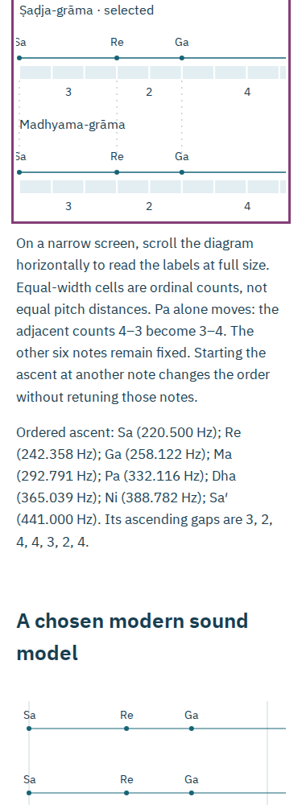

# Operated audit of the count bench and tuning family

The audit repairs learner-visible failures in the existing workshop: interrupted
sound could stop a newer listening request, saved diagrams became unreadably
small on phones, incomplete links reset settings, and a healthy slow source
transfer was aborted. It also extends the source check to both cited books.

The reviewed production inputs are those of source commit `ba4ec87`. Later
example, documentation and review-script changes do not enter the build's edition
hash. This is a local review until the separate public receipts are recorded.
Earlier `tuning-*` records describe their own earlier snapshots.

## Reproduced failures and resulting behavior

| Trigger                                                            | Earlier behavior                                                            | Reviewed behavior                                                                                                                                                                                                                   |
| ------------------------------------------------------------------ | --------------------------------------------------------------------------- | ----------------------------------------------------------------------------------------------------------------------------------------------------------------------------------------------------------------------------------- |
| An older `AudioContext.resume()` rejects after a new Play succeeds | The older catch stops the newer source                                      | Each request owns its context/source revision; stale completions cannot stop a new request                                                                                                                                          |
| Stop, change settings or leave while resume is pending             | Pending work could outlive its experiment                                   | The captured request is invalidated; suspended/closed contexts recover on the next explicit Play                                                                                                                                    |
| Open an illustrated reading at 375 px                              | Diagram text shrinks to roughly 6 screen pixels                             | Diagrams retain their native label sizes in named, keyboard-scrollable regions; printing fits the page                                                                                                                              |
| A settings hash omits fields, repeats fields or adds unknown ones  | Incomplete settings silently choose defaults                                | Reject the settings atomically; the current experiment stays intact. Ordinary reading anchors still work                                                                                                                            |
| A failed whole-gap candidate raises Pa or leaves it unchanged      | Some diagram wording still says lowered                                     | Diagram, table and description state raised or unchanged and retain the failed candidate                                                                                                                                            |
| Reference pitch is 220.5 Hz                                        | Native input validity disagrees with the model                              | Fractional reference pitches are accepted consistently                                                                                                                                                                              |
| A 431,366-byte scan arrives continuously at 4,000 bytes/s          | A 45-second request deadline cuts off the transfer before halfway           | Header and body inactivity are bounded separately; active transfers have no application-wide total-time deadline                                                                                                                    |
| A source sends no headers or stops sending its body                | A save can remain stuck or a retry can reuse a pending HTTP response        | Fifteen seconds of inactivity fails the read; network-only worker fetches use `no-store` to avoid reusing a pending response, while document reads use `no-cache` so Firefox can still use its offline worker; explicit retry works |
| Firefox runs a long worker save                                    | Its worker is terminated at roughly 60 seconds                              | A live document acknowledges its active save or source read; the 108-second transfer completes with default browser preferences                                                                                                     |
| A cached source is replaced with other bytes                       | Raw source images could be displayed without a document-side identity check | The viewer verifies the scan before display, hides the prior page during loading, and exposes retry on failure                                                                                                                      |
| Cancel an illustrated reading while sources are pending            | No cancellation control                                                     | Abort sibling source reads, keep the experiment and allow another save                                                                                                                                                              |
| The initial offline install fails                                  | Recovery relies on reloading or a network transition                        | Retry offline save starts a new registration attempt in the same tab                                                                                                                                                                |
| The origin returns HTTP 503 for a saved lesson                     | A successful HTTP exchange can hide the offline fallback                    | A verified cached document is used for non-success responses as well as connection failures                                                                                                                                         |
| A new edition replaces a tab during repair                         | Readiness must not be inferred from any worker                              | Verify the page's edition and complete inventory; stale tabs offer reload. Writes check native worker ownership                                                                                                                     |
| Export the original bench's JSON, CSV, SVG or WAV                  | Some formats omit the current notice                                        | All current exports retain attribution/license notices. JSON v2 still imports strict legacy v1 records; WAV retains standard PCM with a RIFF INFO notice                                                                            |

## What was actually operated

The [clean-build receipt](audit-clean-build.json) records an isolated `git archive`,
a fresh `npm ci`, lint, DOM and worker type checking, sixteen unit cases, and all
28 production files matching the working build byte for byte. Independent Python
oracles check 28 grama/model/start cases (224 pitches), 7,371 whole-gap candidates
and 91 locked candidates. They use literal tables, closed forms and 50-digit
Decimal arithmetic rather than calling the application's model.

The [bench journeys](audit-bench.json) and [family journeys](audit-family.json)
operate Chromium and Firefox at 1440 and 375 px. They change settings, operate
real audio nodes, download native files, reopen JSON, inspect actual source
images, open the script-free readings and use the app with the local origin and
browser networking disabled. The [interaction audit](audit-interactions.json)
adds deliberately delayed resume success/failure, suspension, closure, source
start failure, pagehide, fractional pitch, strict links, failed-candidate wording
and keyboard scrolling of saved diagrams. Its accessibility checks report zero
violations for the operated portable documents. Pagehide is deliberately
dispatched; this does not claim physical OS interruption testing.

The [original interaction receipt](audit-interactions-before.json) preserves
the late-rejection, incomplete-link and shrunken-diagram failures.
The [before transfer receipt](audit-slow-before.json) retains the actual interrupted
4,000-byte/s requests. The [final network receipt](audit-network.json) and
[cold-install receipt](audit-cold.json) separately exercise:
- slow repair and a slow foreground verified source, each taking over 100 seconds;
- a completely cold install concurrent with a foreground source read;
- header inactivity and body inactivity, followed by successful same-tab retries;
- source substitution, export rejection, cancellation and a subsequent native save;
- damaged-cache detection and repair propagated to a second tab;
- HTTP 503 navigation fallback and origin-disabled reopening.

The server rate is **per response**, not a shared aggregate network cap. These
are real local HTTP responses and native browser workers, not simulated worker
objects or a claim about physical network conditions. Keep the tab open while
saving; a browser may suspend a background document or terminate work after the
user leaves. No readiness is claimed until the complete inventory is verified.

The [failed-install receipt](audit-install.json) separately records held and
substituted initial sources, same-tab retry, corrupt-source rejection, and
successful offline export after restoration.

The [edition replacement receipt](audit-upgrade.json) uses two independently
built editions. The first repair's response sends 128 bytes and remains held;
the second edition installs. Native activation can wait for the old event, whose
body-inactivity deadline releases it. Only after activation removes the old
cache is the old HTTP response released. Both stale tabs then offer reload,
the experiment survives, only the new edition cache remains and the new lesson
reopens offline. This is not a claim that the browser always activates before
old extendable events finish.

The [measured bench audio](audit-bench-audio.json) and
[family audio](audit-family-audio.json) analyze actual downloaded PCM using
independent literal frequencies and interpolated positive zero crossings.
Browser journeys compare the live AudioBuffer's PCM to the downloaded WAV's
actual data chunk. No physical listening or historical performance claim is made.

## Primary pages and portable output

[All eleven retained pages](audit-source-pages.json) were independently rendered
from freshly downloaded primary PDFs whose full SHA-256 values match the
manifest: eight Grosset pages and three pages from the 1894 edition. Each JPEG
is byte-identical to its retained image. Visual review covers the edition title,
chapter opening, counts, lowering instruction, half-verse definition and the
editorial qualification. The model still does not assign pitches to individual
srutis or claim to enact the bracketed two-vina demonstration.

`save-examples.mjs` operates the app's native downloads and prints the script-free
reading only after all eleven images and its embedded fonts decode. The refreshed
22-page A4 PDF has no JavaScript. Its first printed page was rendered and visually
inspected; the two diagrams fit. The phone reading retains readable labels:



The [development receipt](audit-development.json) independently reproduces Vite's
forbidden public-JSON import diagnostic, verifies the retained-source virtual
module reload after a controlled source edit, compares the raw manifest download
and restores the source in an isolated fixture.

## Reproduce

```sh
npm ci
npm run check
npm run verify:oracle
npm run verify:family
npm run test:browser -- /tmp/grama-bench
npm run test:family -- /tmp/grama-family
npm run test:interactions -- /tmp/grama-interactions
npm run test:network -- /tmp/grama-network
npm run test:cold-save -- /tmp/grama-cold
node scripts/offline-failure.mjs /tmp/grama-installs
python3 scripts/verify-family-source.py /path/to/grosset.pdf /path/to/natya1894.pdf
python3 scripts/family-wav-oracle.py /tmp/grama-family
python3 scripts/wav-oracle.py /tmp/grama-bench/chromium-1440
npm run test:source-json -- /tmp/grama-development.json
node scripts/save-examples.mjs /tmp/grama-examples
# Build a second isolated checkout with one intentional index.html title edit:
npm run test:upgrade -- /path/to/first/dist /path/to/second/dist /tmp/grama-upgrade
```

The worker lifetime investigation is consistent with Mozilla's
[worker timeout report](https://bugzilla.mozilla.org/show_bug.cgi?id=2086212).
The implementation's active-transfer and recovery claims rest on the actual
browser receipts, without changing browser timeout preferences.
